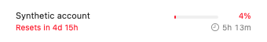
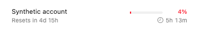

# Reset timing

The menu-bar reset display helps identify the next relevant deadline without
opening the menu. Codex banked reset credits are optional-use inventory with an
expiry date; an expiry is not a prediction that the provider will refill quota.

## Surfaces and consumers

- `StatusItemController+MenuBarLayout.swift` supplies the stored layout renderer.
  `MenuBarLayoutRenderer.swift` renders reset tokens; `MenuBarLayoutEditor.swift`
  also previews these layouts.
- Legacy menu-bar reset-time and exhausted-quota rendering live in the status
  item controller. `StatusItemController+CountdownRefresh.swift` schedules text
  refreshes and deadline changes.
- `Jones/JonesCompactAccountPresentation.swift` supplies account reset details.
  Compact account menus and Overview share the compact account row component.

The percentage retains quota coloring. Reset countdowns use orange, changing to
red within 24 hours. An available Codex credit expiring before the displayed
quota reset supplies the countdown and a trailing hourglass. Expired credits do
not control the display. Healthy account-list reset labels use secondary text;
actual account errors retain error styling.

## Reproducible journeys

Run commands from the repository root, with the toolchain and isolation described
under [Run Tests Only](../DEVELOPMENT.md#run-tests-only). The provided runner owns
its synthetic fixture parent and drains its processes before cleanup. Do not
import a real account or change shared defaults to manufacture these states.

| Entry point | Initial state, action, and observable result | Coverage boundary |
| --- | --- | --- |
| Menu-bar reset display | Use synthetic quota windows and reset credits. Render with weekly reset later than the credit expiry; verify the earlier countdown and trailing hourglass. Repeat with later, expired, and absent credits. | Model/renderer fixtures; installed menu-bar interaction requires separate observation. |
| Countdown refresh | Advance the injected clock through the 24-hour boundary and credit expiry; verify red urgency and fallback to the quota reset or next eligible credit. | Deterministic clock checks, without waiting on wall time. |
| Compact account menu | Supply a healthy account with low remaining quota and a dated reset. Verify neutral reset detail alongside quota severity. Supply an actual account error and preserve its error indication. | Shared presentation/component checks; account activation is outside this task. |
| Overview and layout editor | These consume the same row and reset renderer. Verify shared data propagation; opening every settings/Overview entry remains unverified unless explicitly captured. | Shared-component coverage does not prove all navigation paths. |

## Evidence

Native AppKit/SwiftUI fixture captures use a synthetic account, a fixed clock,
340-point-wide light-appearance canvases, and the actual menu title renderer and
compact account row. They do not capture the installed app or prove navigation,
live account state, or automatic refresh by themselves.

Before, at source `e4dd4d051818f00a5d84e1b5865428c581f112f6`, the title
ignores the earlier credit expiry and the healthy account reset label is red:

With the same synthetic account and deadlines, the updated title shows the
banked expiry and a trailing hourglass; only the account percentage remains red:

A separate 50%-remaining fixture shows an orange credit deadline beyond a day:

The task pull request records the exact source candidate, isolated test results,
native fixture captures, and their limitations. The owner-supplied before images
illustrate the reported behavior but are not a synthetic baseline. Never present
an HTML mockup as a capture of the native app. No live provider or credential
probe is needed for these checks.

Map guidance: `Jones-Systems/Frontend-Development` revision
`e61b1c2794827f210b21e3a2b66b3516acef6196`, UI view maps. This map is partial;
other provider cards, settings navigation, widgets, and accessibility text-size
variants remain outside its verified coverage.
